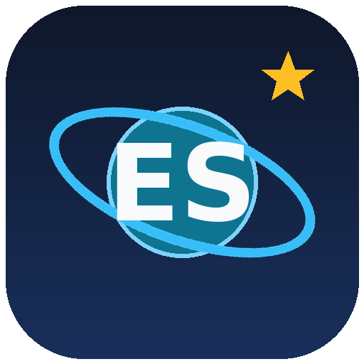

  

<h1 align="center">Traducción al español de Star Citizen</h1>

  

  <b>Descárgalo una sola vez:</b> instala la traducción y la mantiene actualizada sola. 
  <a href="https://github.com/0zzyt0/StarCitizen-Traduccion-ES/releases/latest">Página del instalador</a> ·
  <a href="https://github.com/0zzyt0/StarCitizen-Traduccion-ES/releases?q=INSTALADOR&expanded=true">Todos los instaladores</a> ·
  <a href="https://github.com/0zzyt0/StarCitizen-Traduccion-ES/releases?q=traduccion-v&expanded=true">Historial de traducciones</a>

Traducción de la comunidad de los textos de Star Citizen al español, con un instalador para Windows que
**la instala y la mantiene actualizada sola**. Proyecto no oficial, sin relación con Cloud Imperium Games.

> **¿Qué descargo de la página *Releases*?** Solo la publicación **⬇️ INSTALADOR — Gestor …** (siempre la primera,
> marcada como *Latest*). Las publicaciones **🔄 Traducción …** son las actualizaciones de los textos: el gestor las
> instala solo, **no hay que descargarlas**.

## Descargar e instalar

1. Descarga **[`StarCitizen_Traduccion_ES_Setup.exe`](https://github.com/0zzyt0/StarCitizen-Traduccion-ES/releases/latest/download/StarCitizen_Traduccion_ES_Setup.exe)**
   (el botón de arriba; o en *Releases*, la publicación **⬇️ INSTALADOR — Gestor …**).
2. Ejecútalo. No hace falta ser administrador.
   - Si Windows muestra «Windows protegió su PC», pulsa **Más información → Ejecutar de todas formas**.
     Aparece porque el instalador no está firmado con un certificado de pago; el código es público en este repositorio.
3. Al terminar se abre el asistente:
   - Detecta tus instalaciones de Star Citizen (LIVE, PTU, EPTU, TECH-PREVIEW). Si no encuentra el juego,
     pulsa **Examinar…** y elige la carpeta `StarCitizen` (por ejemplo
     `C:\Program Files\Roberts Space Industries\StarCitizen`).
   - Marca dónde quieres la traducción, revisa el resumen y pulsa **Instalar**.
4. Abre Star Citizen como siempre: los textos estarán en español.

Solo tienes que descargar el instalador **una vez**. Las traducciones nuevas llegan solas.

## Qué cambia en tu juego

En cada canal que elijas:

- Se copia `data\Localization\spanish_(spain)\global.ini` (los textos en español).
- En `user.cfg` se añade `g_language = spanish_(spain)` y, si no lo tenías, `g_languageAudio = english`
  (para no perder las voces). El resto de tus ajustes de `user.cfg` no se toca.
- Se cambia la **pantalla de carga de Easy Anti-Cheat** (`EasyAntiCheat\SplashScreen.png`) por la de la traducción:
  **azul holograma en LIVE** y **violeta en PTU**. Si al arrancar el juego la ves, la traducción está instalada.
  Es opcional (se puede desactivar en el gestor) y la original se guarda y se restaura al desinstalar.
- Antes de cambiar nada se guarda una **copia de seguridad**.

## Actualizaciones automáticas

Si las activas (recomendado), al iniciar sesión en Windows arranca un **vigilante** muy ligero (unos 20 MB de
memoria, sin ventana y sin conexión propia) que comprueba GitHub en dos momentos:

- **Al abrir el RSI Launcher**: si hay una traducción nueva, queda puesta antes de que pulses «Jugar».
- **Al cerrar Star Citizen** (`StarCitizen.exe`): por si se publicó algo mientras jugabas o un parche del juego
  quitó la traducción o la pantalla de carga.

Funciona en segundo plano sin molestar: **solo verás una notificación cuando haya una actualización**.

- Cuando hay una versión nueva, se descarga, se verifica (firma digital y SHA-256) y se instala sola.
- Si un parche del juego borra la traducción o devuelve la pantalla de carga original, se vuelve a poner sola,
  sin avisos.
- **Nunca** se cambia nada con Star Citizen abierto ni mientras el launcher está parcheando el juego.
- Si la versión nueva no está marcada como compatible con tu versión del juego, se pausa y se mantiene la actual.
- Si algo falla, se restaura automáticamente la versión anterior.

En el gestor, pestaña **Actualizaciones automáticas**, puedes:

- Activarlas o desactivarlas.
- Elegir entre *instalar automáticamente* o *solo avisarme*.
- Elegir el canal **Estable** (recomendado) o **Beta** (traducciones en pruebas).
- Activar o desactivar la pantalla de carga personalizada de Easy Anti-Cheat.

Para abrir el gestor: menú Inicio → **Traducción Star Citizen**. Ahí también tienes **Buscar ahora** e **Historial**.

## Volver atrás o quitar la traducción

- **Restaurar copia de seguridad…**: vuelve a una versión anterior de la traducción o al estado original del juego.
  Si vuelves a una versión anterior, no se actualizará sola hasta que salga otra más nueva.
- **Desinstalar traducción**: deja el juego exactamente como estaba (restaura la copia original y revierte
  `user.cfg`).
- Para quitar también el programa: Configuración de Windows → Aplicaciones → *Traducción al español de Star
  Citizen* → Desinstalar. Te preguntará si quieres quitar también la traducción del juego.

## Problemas frecuentes

| Problema | Solución |
|---|---|
| No encuentra el juego | Pulsa **Examinar…** / **Añadir carpeta…** y elige la carpeta `StarCitizen` o la de un canal (`LIVE`). |
| Pide permisos de administrador | Tu carpeta del juego no admite escritura con tu usuario. Acepta «Reintentar como administrador»: solo se tocan `global.ini` y `user.cfg`. |
| «Otra traducción / archivo modificado» | Ya había un `global.ini` que no instaló el gestor. Al instalar se guarda copia y se sustituye; al desinstalar se recupera. |
| «Compatibilidad no verificada» | No se pudo leer la versión del juego o la traducción no declara versiones. Normalmente funciona igual. |
| Sigue en inglés | Comprueba en el gestor que el canal que juegas (LIVE/PTU) está *Actualizada* y pulsa **Reparar**. |
| Sin conexión | El gestor muestra los últimos datos guardados y reintentará más tarde. Tu traducción instalada no se toca. |
| No veo la pantalla de carga azul/violeta | Comprueba en *Actualizaciones → Apariencia* que está activada y pulsa **Reparar** en el canal. |
| Salen textos tipo `@ui_...` | El juego se actualizó y añadió textos nuevos que aún no están traducidos; llegarán en la próxima versión. |

Los registros están en `%LOCALAPPDATA%\SC-Traduccion-ES\logs` (botón **Abrir carpeta de registros** en el gestor).
Si abres una incidencia, adjúntalos: no contienen contraseñas ni datos personales.

## Privacidad

El gestor solo se conecta a `api.github.com` y a los servidores de descarga de GitHub para consultar y bajar las
publicaciones de este repositorio. No envía ningún dato tuyo ni usa telemetría. Todo lo que guarda (ajustes,
historial, copias de seguridad) está en `%LOCALAPPDATA%\SC-Traduccion-ES`.

## Para el mantenedor

Ver [docs/MANTENEDOR.md](docs/MANTENEDOR.md) y [docs/CONFIGURACION.md](docs/CONFIGURACION.md).
